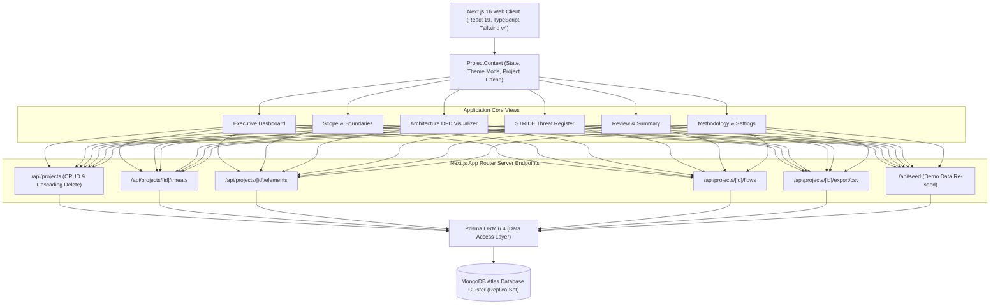
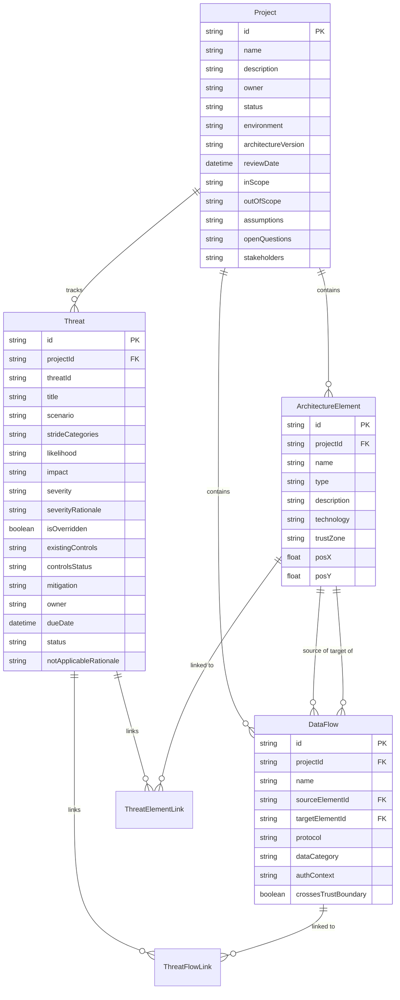
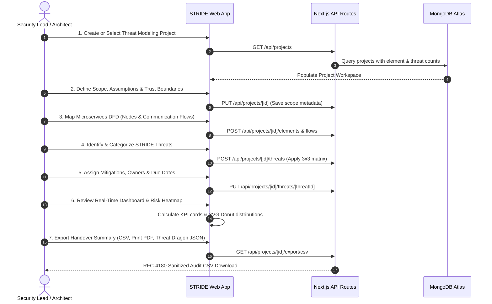

# Product Requirements Document (PRD)

## Project: STRIDE Threat Modeling Workspace for Microservices Architecture

| Metadata | Details |
| :--- | :--- |
| **Product Name** | STRIDE Threat Modeling Workspace |
| **Version** | 1.0.0 (Production Release) |
| **Document Status** | Approved / Living Specification |
| **Author / Lead** | Hardik Naruka |
| **Target Audience** | Application Security Teams, Software Architects, Engineering Leads, DevOps/SRE |
| **Repository** | [https://github.com/hardiknaruka/Stride-Threat-Model](https://github.com/hardiknaruka/Stride-Threat-Model) |
| **Runtime Environment** | Next.js 16 (App Router), React 19, TypeScript, Tailwind CSS v4, Prisma ORM 6, MongoDB Atlas |

---

## 1. Executive Summary & Problem Statement

### 1.1 Background
Modern software engineering has shifted toward distributed microservice architectures. While microservices offer agility and scalability, they exponentially expand the attack surface through interconnected service-to-service communications, distributed data stores, message queues, API gateways, and external third-party integrations.

### 1.2 The Problem
Traditional threat modeling often suffers from critical operational bottlenecks:
- **Fragmented Documentation:** Threat assessments are frequently trapped in static spreadsheets or slide decks that become obsolete immediately after sprint reviews.
- **Subjective Risk Ratings:** Inconsistent severity scoring across different teams without clear qualitative matrices or audit trails.
- **Lack of Architectural Context:** Threats are cataloged in isolation without clear linkage to the microservices, data stores, or communication protocols they threaten.
- **Tooling Silos:** Traditional desktop threat modeling tools (like OWASP Threat Dragon or Microsoft Threat Modeling Tool) lack collaborative web workspaces for tracking mitigation lifecycles, role-based workflows, and automated executive reporting.

### 1.3 The Solution
The **STRIDE Threat Modeling Workspace** is an enterprise-ready, collaborative web application designed to guide security and engineering teams through a structured, repeatable threat assessment study. It couples architectural data flow mapping (DFD) with a standardized STRIDE engine, a deterministic 3x3 risk matrix, an actionable threat register, full lifecycle mitigation tracking, and interoperability with OWASP Threat Dragon 2.x standard schemas.

---

## 2. Product Vision, Goals & Non-Goals

### 2.1 Vision
To establish an open, intuitive, and governance-backed threat modeling standard that enables engineering teams to identify, prioritize, and mitigate security vulnerabilities early in the software development lifecycle (SDLC).

### 2.2 Core Goals
- **Standardized STRIDE Engine:** Eliminate guesswork by systematically addressing all six STRIDE categories (**S**poofing, **T**ampering, **R**epudiation, **I**nformation Disclosure, **D**enial of Service, **E**levation of Privilege).
- **Interactive Microservices DFD Visualizer:** Provide a visual component canvas depicting external entities, processes, data stores, data flows, and trust boundary crossings.
- **Deterministic 3x3 Risk Matrix:** Map Likelihood and Impact into objective severity tiers (Critical, High, Medium, Low) with mandatory audit justification for manual overrides.
- **Lifecycle & Governance Tracking:** Track mitigations from initial triage (`OPEN`) through `ASSUMED` or `VERIFIED` implementation (`MITIGATED`) or formal governance sign-off (`ACCEPTED`, `DEFERRED`, `NOT_APPLICABLE`).
- **Audit-Ready Reporting & Interoperability:** Support one-click CSV audit exports (RFC-4180 with formula-injection guards), formal printable PDF summary reports, and verified OWASP Threat Dragon 2.x JSON model exports.
- **Enterprise-Grade UI/UX:** Clean, accessible Light Theme default with an instant 1-click toggle to sleek Dark Glassmorphism, tailored for both presentation rooms and dark-mode engineering environments.

### 2.3 Non-Goals
- **Replacing OWASP Threat Dragon as a Canvas Drawing Engine:** This workspace is built to organize, score, govern, and track threat-modeling studies. Rather than competing with Threat Dragon, it provides clean bi-directional model compatibility.
- **Automated DAST/SAST Scanning:** This is an architectural threat-modeling platform, not an automated static code scanner or dynamic penetration testing tool.

---

## 3. Target User Personas & Role-Based Access

The application incorporates a dynamic **Role Switcher** that personalizes context, notifications, and governance responsibilities:

| Persona | Primary Role | Core Workspace Objective |
| :--- | :--- | :--- |
| **Security Lead** | Application Security / SecOps | Oversees the entire threat modeling study, approves risk severity overrides, verifies mitigations, and conducts final governance review. |
| **Software Architect** | System / Enterprise Architect | Defines microservice components, data flow protocols, trust boundaries, technology stacks, and architectural assumptions. |
| **DevOps / SRE** | Infrastructure / Platform Engineer | Reviews deployment environments, operational trust zones, denial-of-service resilience, and TLS/mTLS configurations. |
| **Compliance Auditor** | Risk & Governance Officer | Inspects residual risk profiles, accepted risk justifications, audit trails, and exports formal documentation for regulatory compliance. |

---

## 4. System Architecture & Technical Stack

### Technical Stack Details:
- **Framework:** Next.js 16.4.3 (App Router with Server Route Handlers)
- **UI Library:** React 19.3.0 with TypeScript 5
- **Styling:** Vanilla Tailwind CSS v4 with custom glassmorphism design system
- **Database Engine:** MongoDB Atlas (Replica Set / M0+ Cloud Cluster)
- **ORM / Schema:** Prisma ORM 6.4.1 (`provider = "mongodb"`)
- **Validation Engine:** Zod 4.6.7 (Runtime validation for all mutations)
- **Icons & Visuals:** Lucide React (Tree-shakeable modern vector iconography)
- **Automated Testing:** Vitest 5.0.5 with 100% passing unit tests

---

## 5. Functional Requirements (FR)

### FR-1: Project Workspace & Scoping Management
- **Description:** Users must be able to initialize multiple threat-modeling studies representing different applications or microservices domains.
- **Capabilities:**
  - Create projects with Name, Description, Owner/Lead, Target Environment (Production, Staging, Development), and Architecture Version.
  - Document explicit scoping boundaries: **In-Scope Services**, **Out-of-Scope Systems**, **Key Assumptions**, **Open Questions**, and **Stakeholder Roster**.
  - Project deletion feature with a dedicated confirmation modal that safely cascades and deletes all associated microservice elements, flows, and threats from MongoDB without orphaned records.
  - Automatic active project switching upon deletion of the current active project.

### FR-2: Microservices Architecture & Data Flow Visualizer (DFD)
- **Description:** Interactive canvas for modeling microservice topologies based on standard DFD notation.
- **Component Classification:**
  1. `EXTERNAL_ENTITY`: Third-party APIs, user mobile/web clients, external identity providers.
  2. `PROCESS`: Microservices, worker daemons, serverless functions, API gateways.
  3. `DATA_STORE`: Relational databases, NoSQL clusters, cache nodes, object stores.
  4. `TRUST_BOUNDARY`: Network perimeters, VPC boundaries, tenant isolation lines.
- **Flow Modeling:**
  - Directional communication flows linking Source and Target components.
  - Protocol specifications (`HTTPS/REST`, `gRPC`, `Kafka/Event`, `WebSocket`, `AMQP`, `Database Driver`).
  - Automatic flag for flows that cross network trust boundaries (`crossesTrustBoundary = true`).

### FR-3: STRIDE Threat Engine & Taxonomy
- **Description:** Structured vulnerability taxonomy covering all six STRIDE threats tailored specifically for cloud-native microservices:
  - **S (Spoofing):** Forged JWT tokens, API key spoofing, IP impersonation, upstream microservice forgery.
  - **T (Tampering):** In-transit payload manipulation, database record tampering, parameter injection into message queues.
  - **R (Repudiation):** Lack of immutable audit trails, dispute of financial transactions, administrative rule tampering without logs.
  - **I (Information Disclosure):** PII exposure in stack traces, verbose error payloads, unencrypted backups, multi-tenant cross-talk.
  - **D (Denial of Service):** ReDoS attacks, unbounded database queries, resource exhaustion, message broker floods.
  - **E (Elevation of Privilege):** Broken Object-Level Authorization (BOLA), role escalation via JWT claims, vulnerable internal service mesh APIs.

### FR-4: Qualitative 3x3 Risk Prioritization Matrix
- **Description:** Deterministic severity calculation based on Likelihood and Impact:

| Likelihood \ Impact | LOW Impact | MEDIUM Impact | HIGH Impact |
| :--- | :--- | :--- | :--- |
| **HIGH Likelihood** | MEDIUM | HIGH | **CRITICAL** |
| **MEDIUM Likelihood** | LOW | MEDIUM | **HIGH** |
| **LOW Likelihood** | LOW | LOW | **MEDIUM** |

- **Governance Override Rule:** Users can manually override calculated severities, provided they supply an auditable **Severity Override Rationale** to maintain compliance integrity.

### FR-5: Threat Lifecycle & Mitigation Tracking
- **Lifecycle Statuses:**
  - `OPEN`: Newly identified threat under triage.
  - `MITIGATED`: Countermeasure designed and implemented.
  - `ACCEPTED`: Residual risk formally accepted by stakeholders.
  - `DEFERRED`: Mitigation scheduled for a future architectural milestone.
  - `NOT_APPLICABLE`: Threat analyzed and determined outside trust boundaries (requires mandatory rationale).
- **Controls Status:**
  - `VERIFIED`: Countermeasure tested and verified in staging/production.
  - `ASSUMED`: Countermeasure assumed to be operational.
  - `NONE`: No technical control currently in place.

### FR-6: Executive Security Dashboard
- **Description:** Real-time analytics view providing immediate visibility into system posture.
- **Components:**
  - Four primary KPI cards: Total Identified Threats, Critical & High Risks, Mitigation Health Percentage, and Assessed Microservices Count.
  - Interactive pure SVG **Risk Control Donut Chart** (Overdue, Verified, Assumed, Accepted, Deferred, Open Triage).
  - Interactive pure SVG **Risk Impact Distribution Donut Chart** (Critical, High, Medium, Low).
  - Microservices Threat Density Bar Chart (Threats per component).
  - Likelihood × Impact 3x3 Matrix Heatmap with direct filtering into the Threat Register.

### FR-7: Export, Audit & Interoperability
- **CSV Audit Export (`/api/projects/[id]/export/csv`):**
  - Fully formatted, RFC-4180-compliant CSV containing all threat IDs, STRIDE categories, severities, overrides, mitigation owners, due dates, and statuses.
  - **Formula Injection Guard:** Sanitizes fields beginning with `=`, `+`, `-`, `@`, `\t`, or `\r` to prevent CSV injection vulnerabilities in Microsoft Excel.
- **Formal Review & Handover Report:**
  - Clean, dedicated printable layout (`@media print`) rendering on solid white paper with zero visual clutter or UI chrome for regulatory PDF generation.
- **OWASP Threat Dragon 2.x JSON Model:**
  - Full schema mapper converting workspace elements and STRIDE threats into standard Threat Dragon 2.x JSON structure (`tm.Process`, `tm.Store`, `tm.Actor`) with one-click clipboard copying.

### FR-8: Dual Theme System (Light Theme Default & Dark Glassmorphism)
- **Description:**
  - **Default Theme:** Accessible, clean **Light Theme** for all first-time visitors with zero flash of unstyled content.
  - **Dark Glassmorphism:** Deep navy slate background (`#090d16`) with translucent glass panels (`rgba(15, 23, 42, 0.7)`), backdrop blur filters, and vibrant neon accents.
  - **High-Contrast Dark Mode Overrides:** Elimination of washed-out light box reflections across all STRIDE scenarios and diagnostic cards.
  - **Theme Palette Switcher:** Corporate Blue (`#1d4ed8`) vs Modern Tech Teal (`#0f766e`).
  - **Persistence:** Instant preference synchronization with `localStorage` and `document.documentElement.classList`.

---

## 6. Database Schema & Data Models

The application utilizes MongoDB with Prisma ORM 6:

---

## 7. Non-Functional Requirements (NFR)

### NFR-1: Performance & Rendering
- Initial Page Load time under 1.2 seconds on standard broadband connections.
- Client-side navigation transitions under 100 milliseconds using optimized Next.js App Router caching.
- Zero layout shift (CLS < 0.05) through pre-rendered layout templates and static SVG charts.

### NFR-2: Security & Privacy Governance
- **Zero Real Secrets Policy:** Explicit UI warnings advising against entering real credentials, API tokens, or raw PII into threat descriptions.
- **Strict Input Validation:** All mutations validated against strongly-typed Zod schemas on both client and server before database write operations.
- **SQL / NoSQL Injection Immunity:** Type-safe database queries via Prisma ORM parameterized client calls.
- **Formula Injection Mitigation:** Sanitization of all exported CSV fields to prevent remote code execution in spreadsheet software.

### NFR-3: Reliability & Data Integrity
- MongoDB Atlas Replica Set failover resilience with automatic reconnection handling.
- Graceful cascading delete implementation to prevent orphan relational links when deleting microservices, flows, or projects.

### NFR-4: Accessibility & Usability (a11y)
- WCAG 2.1 Level AA color contrast compliance in both Light and Dark modes.
- Keyboard navigation support for all modal dialogs, tab controls, and action triggers.
- Accessible ARIA labels and SVG title tags for screen readers.

---

## 8. User Journey & Workflow Diagram

---

## 9. Success Metrics & Key Performance Indicators (KPIs)

| KPI | Target | Measurement Method |
| :--- | :--- | :--- |
| **Threat Coverage Ratio** | 100% of assessed microservices have at least one STRIDE evaluation | Dashboard KPI card & Threat density analytics |
| **High/Critical Resolution Rate** | > 85% of Critical & High risks mitigated or formally accepted before production launch | Threat Register status tracking |
| **Scoring Consistency** | 100% compliance with qualitative 3x3 Likelihood × Impact matrix | Automated matrix calculation with mandatory audit logs on override |
| **Audit Preparation Time** | Reduced from days to < 5 minutes | Instant one-click CSV export and printable formal review summary |
| **Code Reliability** | 100% test pass rate (17/17 Vitest suites passing) | Automated CI/CD test execution |

---

## 10. Future Roadmap & Enhancements

- **Phase 2 (Q1 2027):** Real-time collaborative multi-user editing with WebSockets / Server-Sent Events (SSE).
- **Phase 3 (Q2 2027):** Direct GitHub / GitLab issue synchronization (automatically creating Jira / GitHub Issues for OPEN high-severity threats).
- **Phase 4 (Q3 2027):** Automated CI/CD pipeline integration (CLI scanner checking for unmitigated CRITICAL threats blocking merge requests).
- **Phase 5 (Q4 2027):** Native bidirectional import of existing `.json` diagrams exported from OWASP Threat Dragon desktop clients.

---

*Document approved by Hardik Naruka for the STRIDE Threat Modeling Workspace project.*
